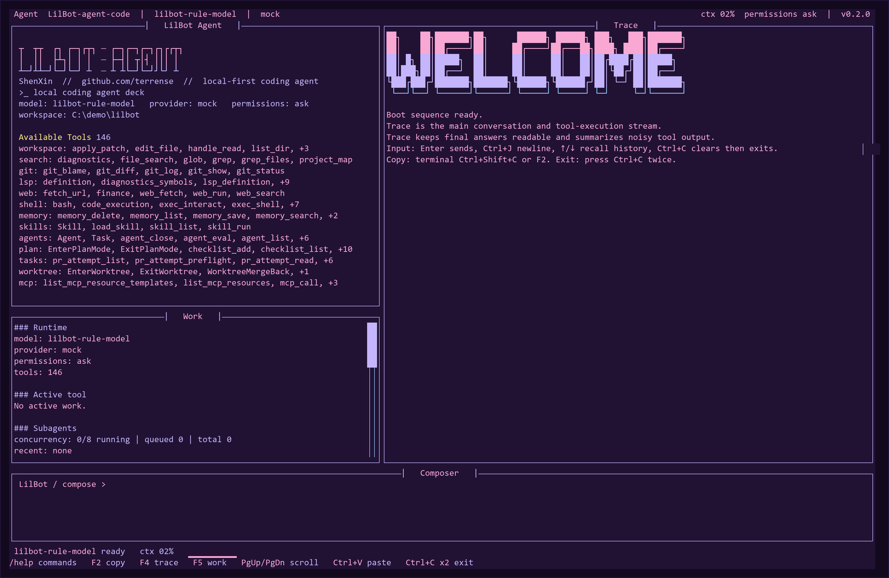
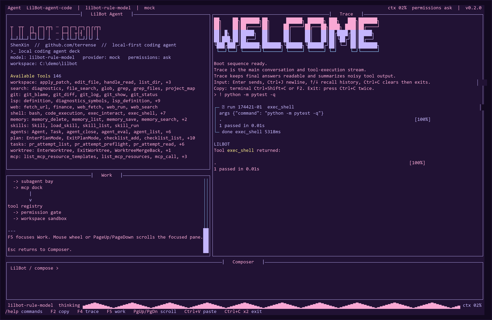
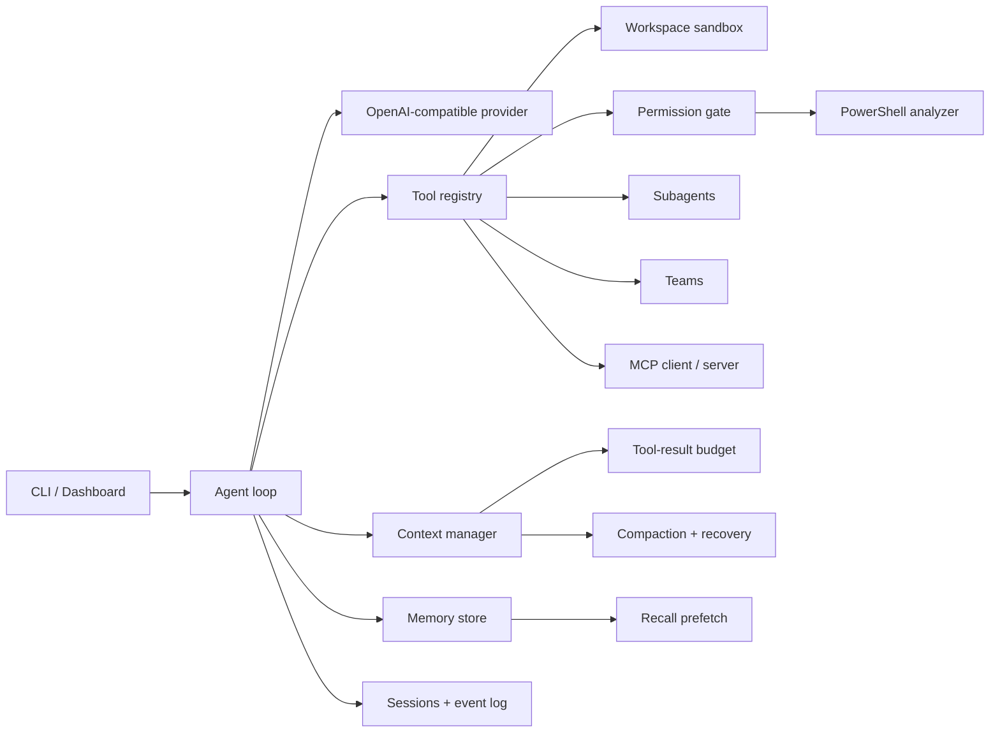

<div align="center">

# LilBot

**A local-first coding agent that runs in your terminal.**

[](#requirements)
[](#requirements)
[](#development)
[](LICENSE)
[](CHANGELOG.md)

[English](README.md) · [简体中文](README.zh-CN.md)

</div>



LilBot is a coding-agent runtime you can read, run, and extend. It gives a model a
workspace, a shell, a permission gate, and durable memory — then gets out of the way.
The core is roughly 20k lines of Python, it speaks any OpenAI-compatible endpoint,
and it ships with an offline provider so the loop can be exercised without an API key.

It is built for the unglamorous parts of an agent: what happens when a tool fails,
when the context is full, when a subagent is still running, when the process dies
mid-turn, or when a model asks to delete something it should not touch.

---

## Why LilBot

- **Local-first.** Your workspace, sessions, memory, and event log live on disk under
  `.lilbot/`. There is no hosted control plane and no account.
- **Model-agnostic.** DeepSeek, OpenAI, OpenRouter, Moonshot, Qwen, Groq, Mistral,
  xAI, a local Ollama/vLLM/LM Studio server — if it exposes OpenAI-style Chat
  Completions, LilBot can drive it.
- **Small enough to audit.** No framework, no plugin runtime, no hidden prompt
  compiler. The agent loop is one generator you can read in an afternoon.
- **Failure paths are first-class.** Retries, fallback, context overflow, output
  truncation, duplicate-call guardrails, and crash-safe session writes all have
  explicit code paths and tests.

## What it does

| Area | What you get |
|---|---|
| **Agent loop** | Event-driven ReAct loop, step budget, transition log, provider retry/fallback, overflow and truncation recovery, cooperative interrupts |
| **Tools** | 146 built-in tools with JSON Schema, input validation, per-input concurrency safety, approval levels, output budgets, deferred loading and `ToolSearch` |
| **Workspace** | Read/write/edit, unified patches, a single pruning walker behind every search, project map, LSP-backed symbols/definitions/references/diagnostics, test runner |
| **Shell** | Foreground and background processes, interactive sessions, cancellation, Windows PowerShell safety analysis, arity-aware read-only allowlists |
| **Context** | L0 tool-result budget, cache-aware pruning, structured summaries, session memory, cycle archive, live token calibration from provider usage |
| **Memory** | File-backed user/project memory, parallel recall prefetch, background extraction, explicit save/list/search/delete |
| **Subagents** | 11 built-in roles, custom markdown agents, five-gate tool allowlists, concurrency cap, transcripts, restart resume, optional git worktree isolation |
| **Teams** | Long-lived in-process teammates, file mailbox with locking and stale recovery, shared task board with dependencies |
| **Safety** | Permission modes, layered `Tool(pattern)` rules, plan-mode gate, secret isolation, output redaction, deny-by-default for destructive shell commands |
| **MCP** | Both sides: connect external MCP servers as deferred tools, or expose LilBot's own tools over stdio |
| **Interface** | Full-screen `prompt_toolkit` dashboard, classic Rich renderer, slash commands, session resume, file rewind |
| **Evaluation** | Isolated mock and live evaluation harness, JSONL traces, grading, metrics, published baselines |

## Quick start

### Requirements

- Python **3.10+** (supported on 3.10–3.13)
- Windows 10/11, Linux, or macOS
- Any OpenAI-compatible model endpoint, or the built-in offline provider

### Install

```bash
git clone https://github.com/terrense/LilBot-agent.git
cd LilBot-agent
python -m venv .venv
```

Windows PowerShell:

```powershell
.\.venv\Scripts\Activate.ps1
pip install -e .
copy .env.example .env
```

macOS / Linux:

```bash
source .venv/bin/activate
pip install -e .
cp .env.example .env
```

Edit `.env` and set one provider:

```dotenv
# Cloud provider
LILBOT_PROVIDER=deepseek
LILBOT_MODEL=deepseek-chat
LILBOT_BASE_URL=https://api.deepseek.com
LILBOT_API_KEY=replace-me

# Local provider (no API key needed)
# LILBOT_PROVIDER=ollama
# LILBOT_MODEL=qwen2.5:3b
# LILBOT_BASE_URL=http://127.0.0.1:11434/v1

# Offline demo (no network, no key)
# LILBOT_PROVIDER=mock
```

### Run

```bash
python -m lilbot
```

The installed console script works too:

```bash
lilbot
```

If you have no endpoint configured, force the offline provider:

```bash
python -m lilbot --provider mock
```

### A 60-second session

```text
> List the files in this project, then run the tests.
  * list_dir  {"path": "."}
  * exec_shell {"command": "python -m pytest -q"}
    Permission gate: allow once / always allow / deny once / always deny
  ok 1 passed in 0.04s
```



The screenshot above is a real capture of the dashboard running the offline
provider against the demo workspace: same agent loop, same permission gate, same
tool execution path as a cloud model.

## Commands

| Command | Purpose |
|---|---|
| `/help` | List commands |
| `/tools` | List registered tools |
| `/skills` | List skills |
| `/memory list\|search\|save\|delete` | Manage persistent memory |
| `/agents` | List subagent roles |
| `/permissions ask\|accept-all\|deny-all` | Change the permission mode |
| `/plan [task]` / `/do` | Enter or approve plan mode |
| `/review [focus]` | Ask the agent to review the current diff |
| `/tokens` | Show context and token usage |
| `/model NAME` | Switch model or provider |
| `/copy` | Copy the trace (dashboard) |
| `/exit` | Quit |

Prefix a line with `!` to run a shell command through the permission gate:

```text
> ! python -m pytest -q
```

## Architecture



The loop is simple on purpose:

1. Build the provider messages from stable prefixes plus current state.
2. Stream a model turn; emit text and tool calls as events.
3. Partition tool calls into concurrent-safe batches and execute them.
4. Feed tool results back as observations, compact if needed, and continue.
5. On a terminal failure, persist the turn and surface a structured error.

Read the details in [Architecture overview](docs/architecture/overview.md) and
[Runtime call chain](docs/architecture/runtime-call-chain.md).

## Safety model

LilBot assumes the model can be wrong, curious, or manipulated:

- **Approval is centralized.** Tools declare an approval requirement; the registry
  enforces it. A new tool cannot silently skip the gate.
- **Layered rules.** `Tool(pattern)` rules come from policy, project, and user
  sources. `deny > ask > allow`, and shadowed rules are reported.
- **Shell analysis.** Catastrophic commands are denied first. Known read-only
  commands use arity-aware prefix matching. PowerShell commands get a token-level
  risk pass for separators, redirection, subprocesses, background launches, and
  destructive delete/move targets.
- **Secrets stay out of reach.** Child processes started by the model lose
  `*_KEY`, `*_TOKEN`, `*_SECRET`, and `*_PASSWORD` variables by default. Commands
  that read secret variables or `.env` files are never auto-allowed. Tool output
  is scrubbed of known secret values before it re-enters the model context.
- **The sandbox is a boundary, not a container.** Paths must resolve inside the
  workspace, but the shell is still a host process. For untrusted code, add a
  container or VM around it.

## Evaluation

LilBot ships an evaluation harness rather than a leaderboard claim. The included
live suite has 24 trials across reading, searching, editing, recovery, guardrails,
permissions, memory, and context tasks.

| Run | Model | Trials | Pass | Success | Median latency | P95 latency |
|---|---|---:|---:|---:|---:|---:|
| 2026-11-04 live baseline | MiniMax-M3 | 24 | 16 | 66.7% | 9.71 s | 21.94 s |

The baseline is intentionally published with its failures and traces. It is a
starting point for measuring regressions, not evidence of frontier parity. The
roadmap below targets a harder suite and a higher pass rate before any such claim
is made.

Runtime micro-benchmarks from the same period:

| Case | Result |
|---|---|
| 10 provider-style HTTP requests | 7,825 ms / 10 TCP connections -> **8.4 ms / 1 connection** |
| `grep` across the repo (no match) | 51.4 ms median |
| `glob` for Python files | 7.8 ms median |
| Session append | 0.071 ms median |
| Plan-state cached read | 0.252 ms median |

## Repository layout

```text
lilbot/                 Runtime package
  core/                 Agent loop, compaction, sessions, events, guardrails
  llm/                  Provider abstraction, retry, error classification
  tools/                Tool registry and 146 built-in tools
  sandbox/              Workspace, permissions, shell policy, PowerShell analysis
  memory/               File memory, recall, extraction
  subagents/            Subagent definitions and lifecycle
  teams/                Mailbox, shared task board, in-process teammates
  hooks/                Event hooks and structured protocol
  mcp/                  MCP client and server
  skills/               Skill registry and bundled skills
  tui/                  Dashboard and classic renderers
evaluation/             Mock and live evaluation harness, baselines, traces
tests/                  660 passing tests
benchmarks/             Runtime micro-benchmarks and results
docs/                   Architecture, design, evaluation, guides, assets
examples/               Small runnable demos
.github/                CI, issue templates, PR template
```

## Development

```bash
python -m pytest tests -q          # 660 passed, 7 skipped
python -m compileall lilbot        # syntax check
ruff check lilbot tests            # lint (optional dev dependency)
```

CI runs the test suite on Python 3.10–3.13 on Ubuntu and Windows. See
[CONTRIBUTING.md](CONTRIBUTING.md) for the full workflow.

## Roadmap

- **Streaming tool execution.** Start safe tools while the model is still
  streaming, with sibling cancellation on failure.
- **VCR fixtures.** Record real provider interactions and replay them in tests so
  the main loop has a regression tape.
- **Harder evaluation.** SWE-bench-style repository tasks, multi-file refactors,
  and adversarial permission cases.
- **Stronger isolation.** Optional container backend behind the existing sandbox
  interface.
- **Team-scale runs.** Distributed teammates and a durable task scheduler.

## Contributing

Issues and pull requests are welcome. Please read
[CONTRIBUTING.md](CONTRIBUTING.md) and [CODE_OF_CONDUCT.md](CODE_OF_CONDUCT.md)
first. For security reports, use [SECURITY.md](SECURITY.md), not a public issue.

## License

MIT. See [LICENSE](LICENSE).
