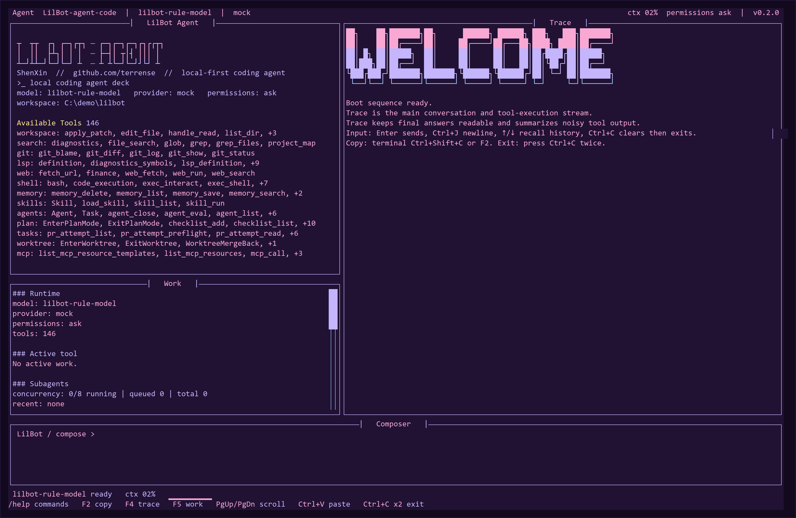
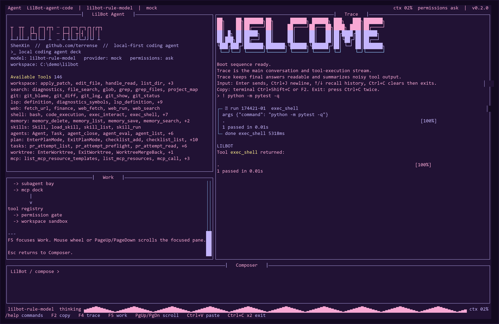
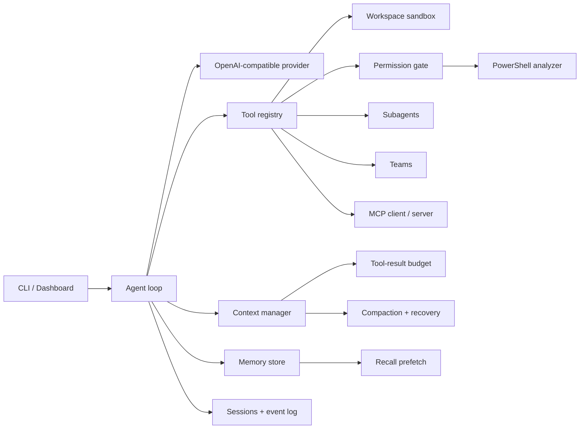

<div align="center">

# LilBot

**跑在终端里的本地优先 Coding Agent。**

[](#环境要求)
[](#环境要求)
[](#开发)
[](LICENSE)
[](CHANGELOG.md)

[English](README.md) · [简体中文](README.zh-CN.md)

</div>



LilBot 是一个你可以读完、跑起来、继续扩展的 coding agent 运行时。它把工作区、Shell、权限门和持久记忆交给模型，然后尽量不挡路。核心大约 2 万行 Python，支持任何 OpenAI 兼容端点，并且自带离线 provider——没有 API Key 也能把整个 Agent 循环跑通。

它真正在意的是那些不体面的细节：工具失败了怎么办、上下文满了怎么办、子代理还在跑怎么办、进程在回合中途被杀怎么办、模型要求删除它不该碰的东西怎么办。

---

## 为什么是 LilBot

- **本地优先。** 工作区、会话、记忆和事件日志都在磁盘上的 `.lilbot/` 里。没有托管控制面，不需要账号。
- **模型无关。** DeepSeek、OpenAI、OpenRouter、Moonshot、Qwen、Groq、Mistral、xAI，或者本机的 Ollama / vLLM / LM Studio——只要说 OpenAI 风格的 Chat Completions，LilBot 就能驱动。
- **小到能审计。** 没有框架，没有插件运行时，没有隐藏的 prompt 编译器。主循环就是一个生成器，一个下午能读完。
- **失败路径是一等公民。** 重试、降级、上下文溢出、输出截断、重复调用护栏、崩溃安全的会话写入，都有显式代码路径和测试。

## 它能做什么

| 模块 | 能力 |
|---|---|
| **主循环** | 事件驱动 ReAct 循环、步数预算、transition 日志、Provider 重试/降级、溢出与截断恢复、协作式中断 |
| **工具** | 146 个内置工具，JSON Schema、输入校验、逐输入并发安全判定、审批级别、输出预算、延迟加载与 `ToolSearch` |
| **工作区** | 读写/编辑、统一补丁、所有搜索共用一个剪枝 walker、项目地图、LSP 符号/定义/引用/诊断、测试执行 |
| **Shell** | 前台/后台进程、交互式会话、取消、Windows PowerShell 安全分析、arity 感知只读白名单 |
| **上下文** | L0 工具结果预算、缓存感知裁剪、结构化摘要、会话记忆、cycle 归档、用 Provider 回报校准 token |
| **记忆** | 文件式 user/project 记忆、并行召回预取、后台抽取、显式 save/list/search/delete |
| **子代理** | 11 个内置角色、Markdown 自定义代理、五道工具白名单 gate、并发上限、transcript、重启恢复、可选 git worktree 隔离 |
| **团队** | 长驻 in-process 队友、带锁和过期回收的文件信箱、带依赖的共享任务看板 |
| **安全** | 权限模式、分层 `Tool(pattern)` 规则、计划模式闸门、密钥隔离、输出脱敏、灾难命令默认拒绝 |
| **MCP** | 双向：接入外部 MCP server 作为延迟工具，或用 stdio 把 LilBot 自己的工具暴露出去 |
| **界面** | `prompt_toolkit` 全屏 Dashboard、经典 Rich 界面、斜杠命令、会话恢复、文件回滚 |
| **评测** | 隔离的 mock 与 live 评测、JSONL trace、评分、指标、公开基线 |

## 快速开始

### 环境要求

- Python **3.10+**（支持 3.10–3.13）
- Windows 10/11、Linux 或 macOS
- 任意 OpenAI 兼容模型端点，或内置离线 provider

### 安装

```bash
git clone https://github.com/terrense/LilBot-agent.git
cd LilBot-agent
python -m venv .venv
```

Windows PowerShell：

```powershell
.\.venv\Scripts\Activate.ps1
pip install -e .
copy .env.example .env
```

macOS / Linux：

```bash
source .venv/bin/activate
pip install -e .
cp .env.example .env
```

编辑 `.env`，选一个 provider：

```dotenv
# 云端
LILBOT_PROVIDER=deepseek
LILBOT_MODEL=deepseek-chat
LILBOT_BASE_URL=https://api.deepseek.com
LILBOT_API_KEY=replace-me

# 本地（不需要 API Key）
# LILBOT_PROVIDER=ollama
# LILBOT_MODEL=qwen2.5:3b
# LILBOT_BASE_URL=http://127.0.0.1:11434/v1

# 离线演示（不联网、不需要 Key）
# LILBOT_PROVIDER=mock
```

### 运行

```bash
python -m lilbot
```

安装后也可以直接用：

```bash
lilbot
```

如果还没有配置端点，强制使用离线 provider：

```bash
python -m lilbot --provider mock
```

### 60 秒演示

```text
> 列出这个项目的文件，然后跑测试。
  * list_dir  {"path": "."}
  * exec_shell {"command": "python -m pytest -q"}
    权限门：allow once / always allow / deny once / always deny
  ok 1 passed in 0.04s
```



上图是 Dashboard 在演示工作区里用离线 provider 跑出来的真实截图：同一个 Agent 循环、同一个权限门、同一条工具执行路径，换成云端模型即可。

## 命令

| 命令 | 作用 |
|---|---|
| `/help` | 列出命令 |
| `/tools` | 列出已注册工具 |
| `/skills` | 列出技能 |
| `/memory list\|search\|save\|delete` | 管理持久记忆 |
| `/agents` | 列出子代理角色 |
| `/permissions ask\|accept-all\|deny-all` | 切换权限模式 |
| `/plan [task]` / `/do` | 进入或批准计划模式 |
| `/review [focus]` | 让 Agent 审查当前 diff |
| `/tokens` | 查看上下文与 token 用量 |
| `/model NAME` | 切换模型或 provider |
| `/copy` | 复制 Trace（Dashboard） |
| `/exit` | 退出 |

以 `!` 开头的行会经过权限门执行 Shell：

```text
> ! python -m pytest -q
```

## 架构



主循环故意保持简单：

1. 用稳定前缀 + 当前状态拼出 Provider 消息。
2. 流式读取模型回合，把文本和工具调用作为事件发出。
3. 按并发安全性给工具调用分批，然后执行。
4. 把工具结果作为观察回灌；需要时压缩上下文，继续下一轮。
5. 遇到终止性失败时持久化本回合，并抛出结构化错误。

细节见 [架构总览](docs/architecture/overview.md) 和 [运行时调用链](docs/architecture/runtime-call-chain.md)。

## 安全模型

LilBot 假设模型会犯错、会好奇、也可能被提示注入操纵：

- **审批集中收口。** 工具声明审批要求，由 registry 强制执行；新增工具无法悄悄绕过权限门。
- **分层规则。** `Tool(pattern)` 规则来自 policy、project、user 三个来源；`deny > ask > allow`，并报告被遮蔽的规则。
- **Shell 分析。** 灾难命令先拒绝；已知只读命令用 arity 感知前缀匹配；PowerShell 再做令牌级风险分析，覆盖分隔符、重定向、子进程、后台启动和危险的删除/移动目标。
- **密钥不可达。** 模型发起的子进程默认剥离 `*_KEY`、`*_TOKEN`、`*_SECRET`、`*_PASSWORD`；读取密钥变量或 `.env` 的命令永不自动放行；工具输出在回灌模型前替换已知密钥原值。
- **沙箱是边界，不是容器。** 路径必须落在 workspace 内，但 Shell 仍然是宿主进程。跑不可信代码时，请在外面再加容器或虚拟机。

## 评测

LilBot 提供评测工具，不提供排行榜口号。内置 live suite 有 24 个 trial，覆盖读取、搜索、编辑、错误恢复、护栏、权限、记忆和上下文任务。

| 运行 | 模型 | Trials | 通过 | 成功率 | 中位延迟 | P95 延迟 |
|---|---|---:|---:|---:|---:|---:|
| 2026-11-04 live baseline | MiniMax-M3 | 24 | 16 | 66.7% | 9.71 s | 21.94 s |

基线连同失败用例和 trace 一起公开。它的用途是衡量回归，不是证明已经达到前沿水平；路线图里会换成更难的 suite，并先把通过率做上去，再谈任何对标结论。

同期的运行时微基准：

| 场景 | 结果 |
|---|---|
| 10 次 Provider 风格 HTTP 请求 | 7,825 ms / 10 条 TCP -> **8.4 ms / 1 条连接** |
| 全仓库 `grep`（无命中） | 中位 51.4 ms |
| `glob` Python 文件 | 中位 7.8 ms |
| 会话追加 | 中位 0.071 ms |
| 计划状态缓存读取 | 中位 0.252 ms |

## 仓库结构

```text
lilbot/                 运行时包
  core/                 Agent 循环、压缩、会话、事件、护栏
  llm/                  Provider 抽象、重试、错误分类
  tools/                工具 registry 与 146 个内置工具
  sandbox/              工作区、权限、Shell 策略、PowerShell 分析
  memory/               文件记忆、召回、抽取
  subagents/            子代理定义与生命周期
  teams/                信箱、共享任务看板、in-process 队友
  hooks/                事件 hooks 与结构化协议
  mcp/                  MCP 客户端与服务端
  skills/               技能 registry 与内置技能
  tui/                  Dashboard 与经典渲染器
evaluation/             mock/live 评测、基线、trace
tests/                  660 个通过的测试
benchmarks/             运行时微基准与结果
docs/                   架构、设计、评测、指南、素材
examples/               可运行的小示例
.github/                CI、issue 模板、PR 模板
```

## 开发

```bash
python -m pytest tests -q          # 660 passed, 7 skipped
python -m compileall lilbot        # 语法检查
ruff check lilbot tests            # lint（可选 dev 依赖）
```

CI 在 Ubuntu 和 Windows 上跑 Python 3.10–3.13 的测试矩阵。完整流程见
[CONTRIBUTING.md](CONTRIBUTING.md)。

## 路线图

- **流式工具执行。** 模型还在流式输出时就开始执行安全工具，失败时中止同批兄弟调用。
- **VCR 录放。** 录制真实 Provider 交互并在测试中回放，让主循环有一盘回归录像带。
- **更难的评测。** SWE-bench 风格的仓库任务、多文件重构、对抗性权限用例。
- **更强的隔离。** 在现有沙箱接口后面加可选容器后端。
- **团队规模运行。** 分布式队友与持久任务调度器。

## 贡献

欢迎 issue 和 pull request。动手前请先读
[CONTRIBUTING.md](CONTRIBUTING.md) 和 [CODE_OF_CONDUCT.md](CODE_OF_CONDUCT.md)。
安全问题请走 [SECURITY.md](SECURITY.md)，不要开公开 issue。

## 许可证

MIT，见 [LICENSE](LICENSE)。
