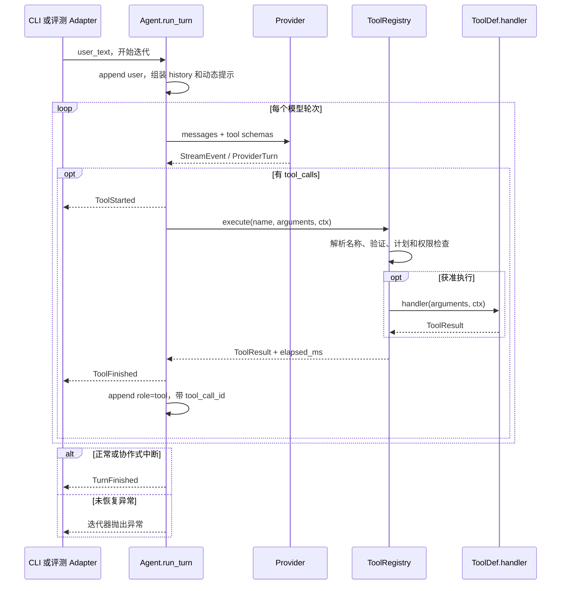

# LilBot 原生 Agent Evaluation 设计

2026-11-04 · 阶段一设计 · 基于 2026-11-04 的工作区，当前 `main` 为 `a941165`

目标是让同一批任务可以重复运行、有证据地评分，并能解释 Runtime（运行时）、Prompt（提示词）或 Model（模型）变化带来的差异。首个实现聚焦离线运行时回归（offline runtime regression），把模型的决策写成受控输入，测量 LilBot 如何处理这些决策。真实模型选工具、遵守提示和完成开放任务的能力需要独立的模型评测。

本设计以仓库内源码为准，并与 `pyproject.toml`、`README.md` 和测试套件的实际行为交叉核对。文中的行号和路径以当前 `main` 分支为准。

## A. 当前架构和调用链

### A.1 入口和数据流

[`pyproject.toml`](../../pyproject.toml#L5) 声明 Python ≥3.10 和 `lilbot = lilbot.cli:main`。`python -m lilbot` 经 [`__main__.py`](../../lilbot/__main__.py) 进入同一个 `main()`。[`cli.main()`](../../lilbot/cli.py#L806) 加载工作区配置、应用 CLI 参数、调用 `build_runtime()`。普通单次输入、经典交互和 Dashboard 的普通输入分别从 `main()`、`interactive_loop()`、[`DashboardUI._process_line()`](../../lilbot/tui/dashboard.py#L865) 到 [`run_prompt()`](../../lilbot/cli.py#L307)，再循环消费 `agent.run_turn(prompt)` 并把事件交给 `ui.event()`。本地斜杠命令有独立分支。评测调用同一个 Agent 入口即可。



1. **装配。** [`build_runtime()`](../../lilbot/cli.py#L158) 创建工作区沙箱、权限、记忆、技能、Provider、子代理、MCP 和团队，注册并配置工具，连接已配置的 MCP 服务，最后创建 `Agent`。[`Agent.__init__()`](../../lilbot/core/agent.py#L167) 用 `build_system_prompt(ctx.memory, ctx.skills)` 生成初始 system 消息，组成为 Constitution、技能清单和持久记忆。评测自己装配依赖，便于控制工具、配置和状态目录。
2. **输入与上下文。** [`run_turn()`](../../lilbot/core/agent.py#L275) 重置本回合的备用 Provider、中断和护栏状态，打开 SessionDB 的回合连接范围，再委托 `_run_turn_body()`。后者追加 user 消息，记录回合开始，处理 hooks、上下文压缩和记忆预取。当前 [`_auto_delegate()`](../../lilbot/core/agent.py#L885) 直接返回 `0`。子代理委派由模型根据可见工具和动态描述发起。
3. **模型调用。** [`_stream_turn()`](../../lilbot/core/agent.py#L1264) 调 `_provider_messages()` 和 `registry.schemas()`，得到历史、临时提醒（例如延迟加载工具、召回、诊断、hooks）和可见工具 schema。`_drive_stream()` 消费 `complete_stream()`，也兼容仅实现 `complete()` 的对象。`BaseProvider.complete_stream()` 默认把一次 `complete()` 包装成终端 `StreamEvent`。`OpenAICompatibleProvider` 把消息和 schema 转成 HTTP 请求体，通过复用的 HTTP client 发送 `POST /chat/completions`。SSE（Server-Sent Events）解析器组装文本、工具调用、usage 和 `finish_reason`。Agent 当前等模型轮次收齐后才调工具，`StreamEvent.tool_call` 的注释描述了可支持的重叠执行，当前驱动逻辑只处理最终轮次和文本。 [Provider 接口](../../lilbot/llm/providers.py#L51) · [HTTP 调用](../../lilbot/llm/providers.py#L514) · [SSE 解析](../../lilbot/llm/providers.py#L273) · [流消费](../../lilbot/core/agent.py#L1367)
4. **工具执行。** Agent 按剩余 `max_steps` 截取调用，将包含 `tool_calls[].id` 的 assistant 消息写入历史。相邻并发安全调用交给 `ThreadPoolExecutor.map()`，其余按单个批次执行。`_run_one_call()` 先过调用护栏和 pre-tool hook，再调用 `registry.execute()`。Registry 建立单次授权作用域，解析名称、验证输入、检查计划审批与工具权限，通过后调用 handler。结果经过脱敏和大输出卸载（offload）。Agent 还可记录文件快照、恢复信息，调用 post-tool hook 或应用 context modifier。 [批次与工具回灌](../../lilbot/core/agent.py#L449) · [单次执行](../../lilbot/core/agent.py#L949) · [注册表执行入口](../../lilbot/tools/registry.py#L467)
5. **观察并继续。** 每个返回的结果递增 `steps`，包括失败、权限拒绝和护栏拦截。`ToolFinished` 发出之后，Agent 才把 `role=tool`、`tool_call_id`、`name`、`content` 追加到历史。下一次模型调用用 ID 将 Observation（工具观察结果）与请求关联，决定继续调用还是回答。工具后的诊断也可进入下一次模型请求。
6. **收敛与失败。** 无工具调用时追加 assistant 文本，输出截断 `finish_reason="length"` 或 stop hook 可能让循环继续。结束时处理 turn-end、记忆任务及持久化，然后产出 `TurnFinished`。到步数上限会用主 Provider 的 `complete(..., [])` 再尝试合成答案，失败或空文本时使用内置兜底。协作式中断会持久化已知进度，产出 `outcome="interrupted"`。异常从生成器抛出，回合内异常通常先尝试保存，SessionDB 初始化等发生在 `try` 外的错误也可能没有终端事件。 [正常终态](../../lilbot/core/agent.py#L412) · [预算和中断](../../lilbot/core/agent.py#L499) · [预算后的合成](../../lilbot/core/agent.py#L1562)

### A.2 如何直接运行 Agent

真实签名是 `Agent(config: LilBotConfig, provider: BaseProvider, registry: ToolRegistry, ctx: ToolContext)` 和 `def run_turn(self, user_text: str) -> Iterator[object]`。这是同步惰性生成器（synchronous lazy generator）。创建迭代器后要推进它，直到耗尽。调试可用 `list(...)`，Runner 应边迭代边写轨迹，保住异常前的证据。读取最终状态前先完成迭代，最后调用 `agent.close()`。以下例子在本机 Windows Python 3.11 已实跑。只给 Agent 注册从内置库取出的单个 `read_file` 定义，输入文件是自建的 UTF-8 文本。

```python
from pathlib import Path
from tempfile import TemporaryDirectory
from types import SimpleNamespace

from lilbot.config import LilBotConfig
from lilbot.core.agent import Agent
from lilbot.core.events import ProviderTurn, ToolCall, TurnFinished
from lilbot.llm.providers import BaseProvider
from lilbot.sandbox.permissions import PermissionManager
from lilbot.sandbox.workspace import Sandbox
from lilbot.tools.builtin import register_builtins
from lilbot.tools.registry import ToolContext, ToolRegistry


class ScriptedRead(BaseProvider):
    def complete(self, messages, tools):
        if messages[-1]["role"] == "user":
            return ProviderTurn(tool_calls=[
                ToolCall("read_file", {"path": "answer.txt"}, "call_read")
            ])
        observation = messages[-1]
        assert observation["role"] == "tool"
        assert observation["tool_call_id"] == "call_read"
        assert "42" in observation["content"]
        return ProviderTurn(content="42", usage={"total_tokens": 10})


with TemporaryDirectory(prefix="lilbot-eval-") as tmp:
    root = Path(tmp)
    (root / "answer.txt").write_text("42\n", encoding="utf-8")
    cfg = LilBotConfig(
        workspace=root, provider="mock", permission_mode="deny-all",
        auto_diagnostics=False, auto_allow_safe_commands=False, max_retries=0,
    )
    catalog = ToolRegistry()
    register_builtins(catalog)
    registry = ToolRegistry()
    read_file = catalog.get("read_file")
    assert read_file is not None
    registry.register(read_file)
    ctx = ToolContext(
        sandbox=Sandbox(root),
        permissions=PermissionManager(cfg.state_dir, mode="deny-all", interactive=False),
        memory=SimpleNamespace(context=lambda: ""),
        skills=SimpleNamespace(list=lambda: []),
        subagents=None, mcp=None, config=cfg,
    )
    agent = Agent(cfg, ScriptedRead(), registry, ctx)
    try:
        events = list(agent.run_turn("Read answer.txt and give its number."))
        assert isinstance(events[-1], TurnFinished) and events[-1].steps == 1
        assert agent.messages[-1]["content"] == "42"
        print([type(event).__name__ for event in events])
    finally:
        agent.close()
```

这段代码产出 `ToolStarted → ToolFinished → TextDelta → TurnFinished`。第二次 `complete()` 能看到同一个 `call_read`，验证了 Agent 将真实注册表执行结果接回模型上下文。`42` 和 10 tokens 是脚本返回值，用来检查数据传递和统计口径。正式 Runner 的脚本还要断言请求顺序、必要 schema、观察内容和脚本是否完整消费，避免意外调用也被当成通过。

## B. 可观测性与评测差距

### B.1 有哪些证据

| 证据 | 当前能拿到的数据 | Adapter 应怎样解释 |
| --- | --- | --- |
| `ToolStarted` | `name`、`arguments`、`started_at`（单调时钟） | 表示已宣告的尝试。中断可能出现在宣告后、实际执行前。参数要在消费时拷贝、规范化、脱敏。 |
| `ToolFinished` | `name`、`ok`、`output`、`elapsed_ms`、`metadata` | 完成事件与启动事件都无 `call_id`。当前批次按提交顺序回报，可按 FIFO 给合成 ID 并校验名称。异常结束允许悬空事件。保留原名与规范名，别名解析复用 `registry.resolve()`。 |
| 工具失败、耗时 | 验证错误有 `validation_error` 和 `error_code`，有些权限和护栏分支有结构化字段。handler 异常通常变成失败文本 | `ok=False` 可能发生于 handler 之前。分类优先用元数据，其余记录 `unknown`。Registry 的耗时含工具权限检查和 handler，排除验证、计划 gate、Agent hooks、脱敏与 offload。提前拦截可能为 0 ms，短操作也会被取整。并发工具耗时之和可高于回合墙钟时间。 |
| `TextDelta` 和最终文本 | `text`、`interim`、`streaming`；完成后有对话历史 | 流式块一律标为 `interim=True`，也包括最终答案。不要拼接整个回合的文本。首版在成功收尾后读取当回合最后的无 `tool_calls` assistant 消息，作为 `final_text`。另保留截断续写或 stop hook 之前的片段，针对长文续写的 grader 要显式定义如何使用这些片段。异常或中断的文本进入 `partial_text`。 |
| `TurnFinished` | `steps`、Agent 累计 `usage`、`outcome` | 普通完成和步数上限都可能 yield 默认 `completed`。当前代码在本地 `EventLog` 里另外写 `step_limit`。首版逐回合匹配独立状态目录里的新增日志，证据缺失时标 `termination_reason=unknown`，保留原始 `outcome`。 |
| `ProviderRetry` 和异常 | `reason`、`action`、`attempt`、`delay`、`detail`；未恢复异常由迭代器抛出 | 区分一次重试、切备用模型、最终错误。反应式压缩重试只写 `recovery` 日志，当前分支没有 yield `ProviderRetry`。可见文本已流出后再失败会直接抛出，避免重复输出。`stream_output=False` 仍可走流式 Provider，但会改变这一分支，比较时应固定配置。 |
| Token 与请求成本 | `ProviderTurn.usage`，Agent 累加整数，Provider 归一化部分缓存字段到 `cache_read_tokens` | 单回合新 Agent 可取终值。多回合按相邻快照做差，仅在同一计量范围且无后台查询竞态时可解释。累计值混合主循环、部分侧查询与合成，不能按实际模型拆账，也不能推断失败请求、子代理消耗。离线脚本用 `synthetic`，空 usage 用 `missing`。 |

字段定义见 [`events.py`](../../lilbot/core/events.py#L9)，错误恢复见 [`_stream_turn()`](../../lilbot/core/agent.py#L1264)，用量汇总见 [`_add_usage()`](../../lilbot/core/agent.py#L1435)。注册表会对部分输出脱敏，但 Trace 还接触调用参数、异常和模型文本，必须独立做字段白名单、大小限制和脱敏。

### B.2 现成组件与空缺

| 现有能力 | 可复用证据 | 评测还缺什么 |
| --- | --- | --- |
| 离线 Provider | `choose_provider()` 支持显式 `mock`，`RuleBasedProvider` 用关键词演示，测试中有可注入的脚本 Provider 和流式假对象 | 版本化的多轮响应和故障脚本，及对意外请求的断言。规则 Provider 可能请求 shell 或 web，离线还需要工具隔离。 [Provider 选择](../../lilbot/llm/providers.py#L702) · [规则 Provider](../../lilbot/llm/providers.py#L367) |
| 本地观测和恢复 | `EventLog` 是每个 state dir 一份的尽力而为（best-effort）JSONL，适合补充 recovery/step-limit。子代理有独立 transcript。SessionStore 增量写 SQLite/WAL，回合末导出 JSON，可加载并迁移旧 JSON | Session 以继续对话为目标，压缩可改写历史，恢复时可为悬空调用补「结果未知」消息。评测要追加式 Trace，明确事件缺失，记录 fixture、版本、评分和可引用证据。 [EventLog](../../lilbot/core/eventlog.py#L29) · [SessionStore](../../lilbot/core/session.py#L89) · [子代理 transcript](../../lilbot/subagents/manager.py#L1281) |
| pytest 与故障注入 | 已覆盖步数上限、读工具并发、重试和 failover、输出流、中断、护栏、日志、权限、SessionDB 恢复、环境变量脱敏 | 单元/集成断言可移植为用例模板。缺任务级 rubric（评分规则）、独立结果校验、批量重跑、版本对比与指标分母。 [循环测试](../../tests/test_agent_loop.py) · [并行测试](../../tests/test_parallel_tools.py) · [流式测试](../../tests/test_streaming.py) · [重试测试](../../tests/test_retry.py) · [中断测试](../../tests/test_interrupt.py) · [会话测试](../../tests/test_session_db.py) |
| benchmark 与演示 | `bench_runtime.py` 测 HTTP 连接、grep、Token 估算、SQLite 追加和 plan cache。`demo_day7.py` 演示权限与 MCP 环境。另有委派矩阵和单次真实任务记录 | 微基准（microbenchmark）回答某段代码快不快，任务评测回答任务有没有做对、怎样失败。可复用故障注入和计时方法。已存在的 `agent_eval` 工具用于获取、等待或发消息给子代理。搜索到的代码里没有完整的 Dataset→Runner→Grader→Report 闭环。 [性能基准](../../benchmarks/bench_runtime.py) · [权限演示](../../benchmarks/demo_day7.py) · [委派探针](../../examples/experiments/delegation_matrix.py) · [agent_eval 实现](../../lilbot/tools/builtin.py#L3427) |

Day 1–7 的日志可直接转成用例线索。连接复用和搜索提速留在微基准，重试、备用模型、token 归一化、回合内增量保存、护栏与中断、权限和环境隔离适合加入运行时回归。复盘中的一次 MiniMax 真任务和 `571 passed / 7 skipped` 分别是历史单点观察和测试记录。本轮另实跑了 9 个相关测试文件的 120 个用例，以及步数/委派筛选的 2 个通过、1 个跳过。统计范围是这些测试，不作为任务完成率。

本地模型接入也要看实际请求路径。`choose_provider()` 可按本地 endpoint 选中 HTTP Provider，但当前 `complete()` 和 `complete_stream()` 都在发送前校验非空 `api_key`。首版明确注入离线 Provider，避免依赖 endpoint 或宿主配置。 [Provider 选择](../../lilbot/llm/providers.py#L702) · [非流式调用](../../lilbot/llm/providers.py#L454) · [流式调用](../../lilbot/llm/providers.py#L514)

## C. 推荐架构及模块职责

```text
Dataset ──任务、fixture、预算──▶ Runner ──隔离环境──▶ Adapter ──▶ LilBot Agent
    │                              │                   │
    │ rubric                       │                   └──事件与观察──▶ Trace
    │                              │                                      │
    └──────────────────────────────┼────▶ Grader ◀────冻结证据与文件快照─────┘
                                   │         │
                                   └──状态───┴──逐试次评分──▶ Metrics ──▶ Report
```

| 模块 | 拥有的责任 | 输入 → 输出 |
| --- | --- | --- |
| **Dataset**（数据集） | 版本化定义目标、场景、fixture、资源预算和可验证的要求。校验重复 ID、引用、字段类型、未知检查类型 | UTF-8 JSONL 与 fixture 清单 → `CaseSpec` |
| **Runner**（执行编排） | 规划 `(case_id, repeat_index, variant)`，创建独立环境，监督时限、收尾和失败分类，安排评分。一例失败后继续其它试次 | `RunSpec + CaseSpec[]` → `TrialResult[]` |
| **Adapter**（运行时适配） | 装配受控 Agent、Provider、工具和权限，推进 `run_turn()`，转换事件、抽取最终答案、上报退出状态。把版本间接口差异收在这里 | `TrialInput + RuntimeVariant + TraceSink` → `RunObservation` |
| **Trace**（执行轨迹） | 为事实分配顺序和证据引用，做归一化、限长和脱敏。记录来源、关联方式和观测缺口。超时保留前缀 | 运行事件和快照索引 → 有版本的 JSONL 与证据引用 |
| **Grader**（评分器） | 用确定性断言检查任务产物、关键动作、安全条件及预期运行状态。评分基于冻结证据，可独立重算 | `CheckSpec[] + Evidence` → `CheckResult[]` |
| **Metrics**（指标） | 按 suite、variant 和错误类别聚合，定义分母、缺失覆盖、成对比较与性能切片 | `TrialResult[]` → `Summary` |
| **Report**（报告） | 渲染 Markdown 和机器可读 JSON，把失败追到 case、check、trace 序号。报告可从已有结果再生成 | `RunManifest + Summary + TrialResult[]` → `report.md/json` |

### C.1 三类检查分开记账

1. **目标（objective）** 由任务环境中的事实判定。例如请求写入 `out/result.txt`，独立检查文件存在、内容精确、其它受保护文件 hash 未变。回复「已写入」和工具返回 `ok=True` 都是运行证据，无法单独证明产物正确。
2. **行为（trajectory）** 检查工具名、约束参数、必要动作、禁止动作和有意义的先后关系。例如「读取目标文件，随后提交结果」，允许配置认可的等价工具。并行只读调用按集合校验，只有因果依赖才约束顺序。
3. **可靠性与安全（reliability and safety）** 检查重试/备用路径、终态和副作用。如预期写入被拒时，应观察到权限拒绝、目标未被改动、假 handler 未进入。该负例的测试结论可以是 pass，工具状态仍是失败。最终异常属于预期注入时也同理。

每条检查返回 `pass | fail | unknown | not_applicable`，以及稳定的 `check_id`、原因和 `evidence_refs`。所有必选检查 `pass` 才判该试次通过，已知违反判 `fail`。必要证据缺失且尚无已知失败时判 `unknown`。`not_applicable` 只用于数据集显式声明的条件，不能用来掩盖丢失证据。Grader 代码崩溃单列为基础设施失败。首版检查类型由代码白名单管理，例如 `final_exact`、`file_sha256`、`tool_match`、`tool_forbidden`、`termination_is`。数据集只声明参数，不执行其中的 Python、PowerShell 或任意 grader 命令。

**例子。** 期望 `write_file(out/result.txt)` 后出现内容 `42`。试次 A 的工具 `ok=True`、最终回复「完成」，但实际文件是 `24`，则操作成功计数加一、任务完成计数不变。试次 B 输出正确文件后达到 step limit，任务目标检查通过，可靠性仍记录 `step_limit`，是否通过整例由该 case 是否要求正常收尾决定。试次 C 刻意拒绝同一写入，若拒绝证据和文件不变都成立，则通过安全回归套件。

### C.2 指标与可比较性

| 指标 | 口径 |
| --- | --- |
| **任务完成率**（task success rate） | `目标通过试次 / 已安排的任务套件试次`。同时报告 `已运行/已安排`、`目标可判定/已安排` 和 `目标通过/目标可判定`。超时或异常按已冻结证据评分，未知计入主分母并单列，避免基础设施变差时指标虚高。故障注入和安全负例单独汇总。 |
| **工具调用质量** | 先报告尝试数、完成事件数、悬空数和 `ok=true / 已完成事件数`（操作成功率）。再报告预期动作覆盖、参数约束通过和禁止动作命中。handler 执行状态仅在有独立证据时计入，生产事件不足时留空。 |
| **运行可靠性** | 按正常、step limit、中断、超时、Provider 异常、运行时异常、基础设施失败和未知分桶。对已知故障场景报告 `达到预期恢复终态 / 已安排的对应注入试次`，并区分 retry 和 failover。 |
| **耗时**（latency） | 用 `perf_counter_ns()` 从推进迭代器前到耗尽或抛错计回合墙钟时间，另报 fixture/setup、worker deadline 与评分耗时。按相同运行范围报告 P50/P95 与样本数，拆分成功和失败/超时样本。首个真实流式块可单报 TTFT（time to first token）的客户端近似。 |
| **Token 与货币成本** | 报告 Agent 已知的 prompt、completion、total、cache read 字段和覆盖率。保留 `null`（缺测）、`0`（已知零）和 `synthetic`（脚本用量）的区别。缓存 token 是输入的子集，不能叠加到总量。首版 `cost_usd=null`。以后按请求和实际模型，以带版本的价格表计算输入/缓存/输出费用，缺少任一必要口径时给出覆盖范围和未知值。 |

聚合时按 `(case_id, repeat_index)` 配对，固定数据集、fixture、工具目录、权限配置、预算、grader、seed（适用时）和计时边界，每次改变一个目标维度。报告 `A pass / B fail`、`A fail / B pass`、共同通过、共同失败和缺失对，列出翻转案例。首版样本少，报告原始计数和配对差值，不做排名或统计显著性结论。比较本机耗时时固定 Windows/Python、并行度与冷/热运行策略。

- **Runtime 比较。** 两个版本接收同一脚本响应、故障与 fixture。Provider 还可断言消息结构，定位协议或工具处理回归。不同 checkout 用不同 worker 加载，记录真实代码标识，脏工作树另记相关源码内容指纹。
- **Prompt 比较。** 离线验证渲染内容、消息位置、工具 schema 及预算影响。使用同一真实模型、相同工具与多次任务重复才能比较提示词引起的行为差异。
- **Model 比较。** 离线验证模型路由和 Provider 协议。后续用固定提示、相同可用工具与盲评分对比模型输出，分别记录实际模型和备用模型。持出集（held-out set）用于降低针对回归集调提示造成的过拟合。

## D. 目录、接口与数据契约

以下是后续实现布局。首版可用标准库 `dataclasses`、`typing.Protocol`、`json`、`pathlib`、`tempfile` 和 `time`。`lilbot/evaluation/` 符合现有 setuptools 包发现规则，生产 CLI 暂不需要新分支。

```text
lilbot/evaluation/
  __main__.py        # python -m lilbot.evaluation
  dataset.py        # CaseSpec / fixture 校验
  runner.py         # RunSpec / 试次生命周期
  adapter.py        # RuntimeAdapter / LilBotAdapter / 脚本 Provider
  trace.py          # TraceSink / 版本化事件
  grader.py         # 确定性检查
  metrics.py        # 聚合和配对
  report.py         # JSON / Markdown
evals/
  runtime-v1.jsonl
  scripts/          # 可信离线响应与故障注入定义
  fixtures/         # 只包含合成数据
tests/              # 保留现有 pytest，增量覆盖评测边界
```

```python
def load_dataset(path: Path) -> list[CaseSpec]: ...

class RuntimeAdapter(Protocol):
    def run(self, trial: TrialInput, trace: TraceSink) -> RunObservation: ...

class TraceSink(Protocol):
    def emit(self, event: TraceEvent) -> None: ...

def grade(checks: list[CheckSpec], evidence: Evidence) -> list[CheckResult]: ...
def run_suite(spec: RunSpec, adapter: RuntimeAdapter) -> RunResult: ...
def summarize(trials: list[TrialResult]) -> Summary: ...
def write_report(run: RunResult, summary: Summary, output: Path) -> None: ...
```

`CaseSpec` 包含 `schema_version`、`case_id`、`suite`、`user_input`、`fixture_ref`、`fixture_digest`、`script_ref`、`environment_profile`、`budgets` 和 `checks`。`TrialInput` 只向 Adapter 提供执行所需字段。脚本文件独立存放，里面的响应和故障序列只供 scripted Provider 使用，评分答案与规则不进入模型消息。首版每例单回合。用固定文本回答的合成脚本可以验证回灌和评分链路，场景名应明确标记运行时回归。

```json
{"schema_version":1,"case_id":"runtime.read_fixture","suite":"offline_runtime","user_input":"读取 answer.txt 并报告其中的数字","fixture_ref":"read-number","fixture_digest":"sha256:<fixture 内容指纹>","script_ref":"read-number-v1","environment_profile":"text-read-v1","budgets":{"max_steps":4,"wall_timeout_s":5},"checks":[{"id":"answer","kind":"final_exact","expected":"42"},{"id":"read","kind":"tool_match","name":"read_file","args":{"path":"answer.txt"}}]}
```

`RunObservation` 分开记录 `execution_status`（迭代完成、中断、异常、超时或基础设施错误）、`agent_outcome`（公开事件值）和 `termination_reason`（明确证据支持的详细原因），另含 `final_text`、`partial_text`、`elapsed_ms`、`usage`、`trace_complete` 与 `evidence_refs`。Runner 每试次只写一条 `TrialResult`，包含上述状态、独立评分和快照引用。Provider 脚本校验失败若由实际调用偏离预期触发，归入运行时契约回归。输入脚本本身无效时在运行前判配置错误。

`TraceEvent` 包含 `schema_version`、`trial_id`、`turn_index`、`seq`、`observed_offset_ms`、`kind`、`source`、`payload`。工具额外保存 `tool_seq`、`requested_name`、`canonical_name`、可空的 `provider_call_id` 和 `correlation`（如 `fifo` 或 `native_id`）。当前 Agent 可用 `turn_index + tool_seq` 作为配对键。乱序、名字不符或结束缺失应记录质量标志，避免猜测配对。中断在批次前发生时，保留已宣告未匹配的工具，避免把它们计作 handler 执行。

建议一次运行产出 `manifest.json`、`traces/<trial_id>.jsonl`、`results.jsonl`、`report.json` 和 `report.md`。Manifest 固定 dataset/fixture/script/grader/schema 指纹、代码版本、prompt 摘要、模型配置名、工具目录、预算、OS/Python 和重复参数。Trace 每条边消费边脱敏落盘，父进程可在 worker 退出后保留完整行及最后状态。结果与报告用临时文件后原子替换，便于检查批次中断。只保留可评分的合成证据和允许的产物快照或摘要，省略 reasoning、密钥、主机绝对路径和任意工作区内容。对 hash 检查保留字节摘要，对文本检查保留脱敏后仍可评分的字段，证据不可用时给 `unknown`。同一冻结证据可重评分（regrade），无需再调用 Agent。

### D.1 Windows 工作区与高风险工具隔离

每个试次用本机临时磁盘上的独立 workspace、新 `LilBotConfig`、registry、权限管理器、Provider 和 Agent。`config.state_dir` 固定为 `workspace/.lilbot`，隔离 workspace 同时隔离 SessionDB/WAL、权限规则、历史、offload 和日志。Session ID 只有秒级粒度，独立目录也避免同时开始的试次混用状态。Runner 将 fixture 与评测产物分开，期望答案、canary、评分规则和报告都放在模型工具的工作区之外。无需 `load_config()` 或 CLI `build_runtime()`，避免读宿主 `.env`、发现旧配置和连接 MCP。记忆提供惰性的空上下文，技能用空清单，subagents/MCP/teams 置空，无 `hooks.json`，关闭自动诊断和 shell 自动放行。使用显式脚本 Provider，默认 `max_retries=0`、备用与辅助模型为空。注入重试和备用模型的用例使用单独配置和假 Provider。 [配置与状态目录](../../lilbot/config.py#L17) · [CLI 装配](../../lilbot/cli.py#L158)

| 风险面 | 首版处理 |
| --- | --- |
| 文件写入、编辑、删除、patch、记忆与计划状态 | 默认 `PermissionManager(mode="deny-all", interactive=False)`，只注册用例需要的叶子工具。允许写用例仅对特定 fixture 文件注册实际 `write_file`，设置 `ask` + `interactive=False` + 精确的 `write:<relative path>` 测试规则，并在输入边界限制路径。拒绝用例保留目标工具并使用 in-root 文件，验证真实权限闸门。保持最终文件和哨兵的内容校验。 [权限管理](../../lilbot/sandbox/permissions.py#L60) · [写工具](../../lilbot/tools/builtin.py#L528) |
| 路径穿越与隐式读取 | 仅接受 fixture 声明的规范相对路径和合成 UTF-8 文件，校验复制入口、Provider 参数及评分快照。拒绝绝对路径、驱动器限定路径、UNC、ADS、`..`、symlink、junction/reparse point，限制 `.lilbot` 和评测元数据读取。`Sandbox.resolve()` 有根目录校验，但搜索遍历和文件历史另有入口。`read_file` 读 PDF 会启动 `pdftotext`，首版只给它固定 `.txt` 路径。 [Sandbox](../../lilbot/sandbox/workspace.py#L39) · [read_file](../../lilbot/tools/builtin.py#L507) |
| Shell、交互式进程、`run_tests`、代码执行、RLM | 省略工具或用无副作用 stub。`Sandbox.run()` 设置 cwd、过滤部分环境变量并为 PowerShell 设置超时，它提供的边界有限。`rlm_eval` 甚至在 Python 进程内 `exec`。工具权限可拒绝调用，不能替代 OS 进程、文件和网络隔离。 [Sandbox.run](../../lilbot/sandbox/workspace.py#L107) · [RLM](../../lilbot/tools/builtin.py#L3512) |
| Web、MCP、Git/Worktree、hooks、技能、子代理和团队 | 省略能联网、启动 Git/其它进程、写状态或异步派生的工具。只读并发标签也可能包含 Web、Git、LSP。禁用可间接派发的 `parallel`/`ToolSearch` 等工具，注册闭包可能绑定原完整 registry。延迟工具直接按名称请求仍可被执行，所以 schema 隐藏没有授权作用。MCP 配置可显式加入环境变量，hook 命令也可复制宿主环境。 [组合调用](../../lilbot/tools/builtin.py#L3806) · [延迟工具执行](../../lilbot/tools/registry.py#L472) · [MCP 环境](../../lilbot/mcp/client.py#L22) · [hook 命令](../../lilbot/hooks/engine.py#L46) |

**已复现的前置快照风险。** `_run_one_call()` 在进入 `ToolRegistry.execute()` 之前调用 `_snapshot_before_edit()`。`FileHistory.record()` 解析目标后可直接读取并备份，当前未校验解析后的路径仍在 workspace 内。用临时目录、空 registry 和 `deny-all` 实测请求 `write_file(path="../outside.txt")`，结果显示 `Unknown tool: write_file`，但 `.lilbot/filehistory/1.bak` 已包含工作区外合成哨兵的字节。工具注册白名单只能保护注册表执行入口。首版必须在 scripted Provider 返回 `ProviderTurn` 或流式终端结果**之前**验证所有 `ToolCall`，包括最终会被拒绝、未注册或被步数预算裁掉的调用。后续接入任意模型输出前，需要给 `FileHistory` 增加路径边界检查并做 Windows 回归。 [前置快照入口](../../lilbot/core/agent.py#L949) · [目标提取](../../lilbot/core/agent.py#L1051) · [备份实现](../../lilbot/core/history.py#L42)

首版单回合减少后台状态干扰。当前记忆抽取和 session notes 每隔 3 和 4 个回合可启动 daemon，记忆召回在有可用记忆条目时也会预取。`Agent.close()` 关闭 Provider 和 session，但不等待这些任务。多回合场景要显式控制侧请求，再引入统计。运行预算同时包括 `max_steps` 和外部墙钟 deadline，因为步数只计工具，遇到阻塞 Provider 或 handler 时不会自动停下。`request_interrupt()` 是协作式中断。支持硬 deadline 时使用独立 worker，父进程允许短暂收尾，超期终止 worker 并标记部分 Trace。首版 worker 禁止派生子进程。未来开放子进程时还需单独设计 Windows Job Object 或等价的进程树生命周期控制，以及 OS 级文件与网络隔离。Windows worker 使用显式的最小环境白名单，保留 Python 启动所需的系统变量，使用独立 `TEMP`，不转发密钥、代理或配置覆盖环境。 [后台任务](../../lilbot/core/agent.py#L721) · [回合取消](../../lilbot/core/agent.py#L292) · [关闭资源](../../lilbot/core/agent.py#L1355)

## E. 实施计划和验收

| 阶段 | 交付 | 验收标准 |
| --- | --- | --- |
| **0 · 设计与验证**（本阶段） | 当前调用链、证据边界、接口与隔离设计 | 在 Windows venv 里直接跑 Agent 和真实读工具，检查 tool call ID 回灌、最终文本与事件顺序。源码、历史数据和本轮验证分开记录。 |
| **1 · 最小离线闭环** | 七个模块的最薄切片，串行单回合，支持真实只读工具和受限 fixture 写入。运行命令形态为 `python -m lilbot.evaluation run evals/runtime-v1.jsonl` | 在干净环境下无需真实 Key、网络或交互即可完成。固定数据集两次运行的检查结果、归一化轨迹和聚合计数一致，忽略 UUID/时间/临时路径。至少有正确产物、回复声称成功但产物错误、预期拒绝三种验证。报告从失败行能跳到检查和具体证据。 |
| **2 · 故障、时限和版本对比** | 加入可监督 worker、结构化错误、证据重评分和成对报告。补充权限及 Windows 边界用例 | 覆盖下面的验收矩阵。一个 worker 超时或异常时其余 case 继续，部分轨迹可读，关闭 SQLite 后临时目录可清理。两个已知不同的 Runtime 版本在相同 dataset 下给出预期翻转，且缺失对单列。 |
| **3 · 真实 Prompt/Model 评测** | 通过独立 profile 运行，先用同一受限工具目录和真实模型多次采样，再按需要增加 per-request usage | 先修复并验证快照路径边界。固定 held-out 数据集和 grader，保留模型版本、提示摘要、实际路由和调用费用口径。用有明确正确产物的任务验证评分，再扩大到人工可校准的开放任务。 |

阶段 1 仅运行已知有限的可信脚本，先启用 `max_steps`。从阶段 2 起支持示例中的 `wall_timeout_s`，前一阶段对声明了硬时限的用例报配置不支持，避免预算被静默忽略。

阶段 1–2 的用例可逐步加入以下验收矩阵。检查字段、文件和计数时使用合成夹具与固定脚本，性能阈值另按微基准维护。

| 场景 | 关键断言 |
| --- | --- |
| 直接回答、读取后回答、写文件后验证 | 调用次数和最终答案与 case 一致。读回的 tool message 关联正确。真实写入只出现在允许的目标路径，内容与 hash 正确。故意给错内容时 grader 必须失败。 |
| 批次与流式输出 | 两个同名并发工具能用序号分开，配对与模型给出的顺序一致。工具前中间文字与最终文本分开。中断时允许悬空 start。 |
| 步数上限、循环护栏 | 未执行的超预算调用没有工具完成事件，步数上限和正常完成区分。重复失败触发护栏时，handler 计数与宣告次数分别验证。 |
| 429/503、认证失败与备用模型 | 注入可恢复错误后有相应 retry，最终成功。重试耗尽后可以切换到假备用模型。认证或不可恢复错误走预期终态。可见流中途失败时不会重复播放。 |
| 权限和路径 | deny-all 保留只读能力，写 handler 未进入。预校验拒绝越界、绝对/驱动器/UNC 路径、ADS 和 junction/reparse fixture，外部合成哨兵未变且未被快照。直接请求未注册高风险工具不能执行。 |
| 中断、硬超时、观测缺口 | 在 `ToolStarted` 后请求中断时检查工具未执行。阻塞假 Provider 超时后 Runner 输出 `timeout` 并继续。丢弃本地终止日志时 `termination_reason=unknown`。没有 usage 和明确报告 0 的 fixture 汇总不同。 |
| 重评分与配对 | 不启动 Provider 即可从冻结证据重算相同结果。配置不可比时报告差异来源，缺失样本不被当作配对改进。 |

## F. 关键取舍与生产改动预算

- **走真实生产入口，替换 Provider。** 测试替身（test double）负责控制 LLM 决策与故障，Agent 和 registry 保留真实执行。这样能捕获协议、权限、恢复和状态回归，任务脚本的通过率只代表受控行为的可靠性。真实模型质量用单独的评测协议。
- **优先产物评分和结构化事实。** 可验证文件、状态及轨迹比最终回复稳定。对开放任务，等积累人工复核样本再引入 LLM-as-judge（模型裁判），评估评分一致性和偏差，并单独计算裁判开销。
- **复用公开事件，本地日志补证。** 离线 MVP 可以零生产改动落地。Adapter 内集中管理现有事件的顺序、历史快照、日志匹配和降级规则。若后续需要跨版本可靠关联，可给 `ToolStarted/ToolFinished` 增加可选 `call_id`，保留原有字段、默认值和构造方式。若步数上限必须从事件直接判断，可给 `TurnFinished` 增加可选 `termination_reason`，保留 `outcome` 的既有语义，覆盖 CLI/TUI 消费测试。每个字段等有实际使用者和用例再加。
- **快照边界修复优先于扩大信任范围。** 接入任意模型输出前，最小改动是在 `FileHistory.record()` 读取之前验证解析后仍在 workspace 内，覆盖 Windows 路径、链接与拒绝分支。正常合法编辑应仍有快照。若要进一步保证被拒工具完全不触发备份，可将快照挂在已通过权限且即将写入的执行边界，另验证权限、并发和恢复行为。本次复现只用了合成文件，生产修复单独实施。
- **把实验计量和账单计量分开。** 离线用 synthetic usage 验证汇总。真实成本需要记录请求角色、实际 Provider/model、成功与错误状态、返回 usage 及缺测，避免把累计计数和分请求数再相加。启动这类观测时再评估一个最小 Provider 观测接口。
- **本地文件优先。** UTF-8 JSONL 支撑增量追加、定位失败和重新汇总。先用 Python 3.10+ 标准库、现有 venv 和已有测试，生产会话继续由现有 SessionStore 管理。首版的样本规模和查询需求用本地输出即可覆盖。
