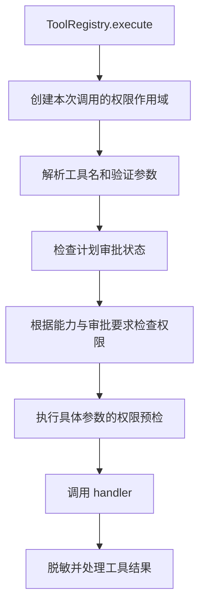

# Day 7 权限收拢与 MCP 环境隔离报告

日期为 2026-11-04。本次对应七天计划的最后一天，包含权限入口统一、MCP 子进程环境隔离、依赖范围约束、总回归和七天复盘。

## 1. 修改前后的实际行为

| 场景 | 修改前 | 修改后 |
|---|---|---|
| 新工具声明写文件能力，handler 忘记检查权限 | 注册表直接执行 handler，存在漏审批的入口 | 注册表根据能力声明统一检查，拒绝后 handler 不会执行 |
| deny-all 下运行白名单 shell 命令 | shell 白名单可能直接允许 | shell 执行入口先检查 deny-all，即使命令属于安全白名单也会拒绝 |
| 同一调用内注册表和 handler 检查相同 action | 直接增加检查会让“允许一次”被询问两遍 | 同一次调用只复用完全相同 action 的决策，调用结束后授权过期 |
| 用户只批准外层工具，handler 又请求更窄权限 | 缺少统一的临时授权边界 | 不同 action 分别授权，嵌套工具调用有自己的作用域 |
| 常驻 MCP 服务启动 | 默认继承父进程环境，包含模型凭据 | 先过滤敏感名称，再合入用户在 server.env 中显式配置的变量 |
| 旧版一次性 MCP 调用 | subprocess.run 默认继承环境 | 使用与常驻客户端相同的环境构造逻辑 |
| 发现并注册外部 MCP 工具 | 缺少副作用声明，默认直接调用 | 默认需要审批，拒绝时不会发送工具 RPC |
| 计划等待批准时调用扩展工具 | 静态工具名清单可能遗漏新工具 | 计划闸门结合工具能力声明判断是否应阻止 |

## 2. 权限如何沿正常入口生效



注册表会检查 `WritesFiles`、`ExecutesCode`、`RequiresApproval` 和 `approval_requirement`。对有风险的工具，如果权限管理器缺失，会返回拒绝结果。这种行为称为默认拒绝（fail closed）。参数验证失败或计划审批未完成时，会在 handler 执行前返回。

已有 write、edit、patch、Python、JavaScript、shell 等工具保留原来的具体权限键。新增的 `permission_check` 预检复用这些逻辑，因此原来保存的路径权限和命令权限继续生效，PowerShell 风险摘要也会继续参与审批。

`PermissionManager.tool_scope()` 使用 `ContextVar` 保存单次工具调用内的决策。注册表和 handler 如果检查同一个 action，就复用本次结果。不同参数形成的 action、嵌套调用和并发线程分别处理。这样既避免常见的重复询问，也不会把一个通用工具的批准扩散为任意路径或任意命令的授权。

本次也补充了工具能力声明。工作区文件写入、持久记忆修改、外部 GitHub 变更、automation 修改、worktree 变更、Python/RLM 执行、运行进程的 stdin 输入等，都需要相应权限。新发现的 MCP 工具默认要求审批，服务端提供的只读提示不会自动免除审批。

### deny-all 的具体语义

deny-all 拒绝工具层声明的写入、代码执行和需审批操作，优先于 shell 白名单。

会话保存、计划、checklist、任务和团队协调等内部状态记录采用各自的运行时生命周期。只读 git 工具内部也可能启动受控子进程。deny-all 的边界按工具能力定义。

## 3. MCP 环境如何隔离

`mcp_child_env()` 负责构造子进程环境。常驻 `StdioMCPClient.start()` 和兼容的 `MCPManager.call_tool()` 都会调用它。

```text
父进程环境
    ↓ scrubbed_env
过滤 API_KEY、TOKEN、SECRET、PASSWORD 等敏感名称
    ↓ 合入该 MCP 服务显式声明的 env
启动 MCP 子进程
```

PATH、SystemRoot 等普通环境变量会保留。如果某个 MCP 服务需要凭据，应在它的 `env` 中明确配置。例如可以把父进程的 `MY_SERVICE_TOKEN` 映射给指定服务。

```json
{
  "servers": {
    "example": {
      "command": "python",
      "args": ["path/to/server.py"],
      "env": {
        "SERVICE_TOKEN": "${MY_SERVICE_TOKEN}"
      }
    }
  }
}
```

显式配置支持原来的环境变量展开。已有的 `LILBOT_CHILD_ENV_ALLOW` 也能显式放行变量，因此“默认过滤”和“用户显式授权传入”具有不同结果。测试分别覆盖这两类输入。

本次还处理了子进程的失败清理。握手和工具发现失败后会关闭服务，正常关闭时等待进程退出并释放管道，减少 Windows 临时目录被遗留句柄占用的问题。

## 4. 依赖范围

| 依赖 | 本次约束 | 实际回归版本 |
|---|---|---|
| httpx | `>=0.27.0,<1` | 0.28.1 |
| prompt_toolkit | `>=3.0.0,<4` | 3.0.53 |
| rich | `>=13.0.0,<16` | 15.0.0 |

两个依赖声明文件已同步上界。`requirements.txt` 原有的 prompt_toolkit 最低版本 3.0.43 继续保留。

原计划给 Rich 的上界是 `<15`，当前虚拟环境已经安装了 15.0.0。本次选择 `<16`，使声明覆盖实际执行回归的版本。这是相对原计划的一项调整。

## 5. 回归中实际发现和修复的问题

Day 6 这次新增了 17 个验收用例，并修复了三处边界问题。

- 发布 `ToolStarted` 事件后发生中断，handler 仍会继续执行。现已增加执行前检查点。
- 最后一个工具恰好达到 `max_steps` 时，中断会被最终总结流程越过。现已在整批结果持久化后检查中断。
- 交替使用同一工具的大小写和别名会分散护栏计数。现已使用注册工具的规范名称统一计数。

首轮全量回归还暴露了并发邮箱丢消息和子代理收尾持久化的生命周期问题，修复与最终结果记录如下。

邮箱在同一实例的线程之间增加互斥，跨进程继续使用文件锁。获取文件锁耗尽后会明确失败，修复了旧逻辑可能无锁写入并删除其他写入者锁文件的问题。子代理在 worktree 清理、终态 transcript 和最终快照持久化完成后才发布 completed/failed。收尾 I/O 故障会转为可见的内存 failed 状态并释放并发配额，该故障情况下失败状态的落盘仍受磁盘可用性限制。

最终冻结代码后运行完整测试。

```powershell
.\.venv\Scripts\python.exe -B -m pytest tests -q -p no:cacheprovider
```

结果为 **571 passed / 7 skipped / 9 subtests passed，26.53 秒，0 failed，0 warnings**。相对 Day 5 的 515 个用例新增 56 个，包含 Day 6 的 17 个、Day 7 权限的 26 个、MCP 的 9 个和并发收尾的 4 个。

依赖版本与声明范围检查通过，`git diff --check` 通过。离线体验脚本已通过实际运行。

## 6. 离线基准与真实任务

基准命令可以重复运行。

```powershell
.\.venv\Scripts\python.exe -B benchmarks\bench_runtime.py --json
```

| 指标 | 修改前模式或历史基线 | 本次测量 |
|---|---|---|
| HTTP client 创建 | 本轮重现旧模式 810.2 ms/次 | 共享工厂 0.2 ms/次，一次性 SSL 初始化 277.3 ms |
| 本地 SSE 连续 10 次请求 | 本轮旧模式 7,825.5 ms、10 条 TCP | 8.4 ms、1 条 TCP |
| 仓库 grep 无匹配 | Day 0 1,739 ms | 51.4 ms，3 次中位数 |
| glob `**/*.py` | Day 0 1,084 ms、1,793 行，包含虚拟环境 | 7.8 ms、122 个结果，3 次中位数 |
| SQLite 单条消息提交 | Day 5 中位数 0.065 ms、P95 0.097 ms | 中位数 0.071 ms、P95 0.096 ms |
| 新建 SQLite 初始化 | Day 5 记录 8.55 ms | 本轮 10.705 ms |
| 审批状态读取 | 本轮旧式读取解析中位数 0.587 ms | mtime 缓存 0.252 ms，200 次样本 |

HTTP 数据来自本地假服务器，其中旧模式和优化模式在同一个脚本中运行。这个对比衡量连接开销。grep 的耗时相对历史基线约缩短 34 倍，glob 约缩短 139 倍，后者也受虚拟环境被剪枝的影响。实际模型服务还包含推理和网络延迟。

SQLite 新建库耗时存在波动。同一天早先五轮样本约为 110–118 ms，后续两轮为 12.31 ms 和 10.705 ms。稳态提交仍符合每条低于 2 ms 的验收线，初始化波动的原因尚待定位。原始数据保存在 [Day 7 结果文件](../../benchmarks/results/day7-2026-11-04.json)。

MiniMax-M3 的真实只读任务通过正常 CLI 入口运行，要求用 grep 和 glob 找到 `jittered_backoff` 定义并统计 `lilbot/` 下的 Python 文件。完成了 4 次工具调用，进程总耗时 25.72 秒。独立核对确认定义在 `lilbot/llm/retry.py` 第 19 行，文件数量为 68。保存的会话为 `20261104-100453`，包含 9 条消息和 4 条工具结果。

这次任务比 Day 4 记录的 2 步、5.8 秒更慢。模型额外做了两次核对，任务总时间也受模型与网络延迟影响，这个真实任务结果只用于验证正确性，性能对比使用离线基准。

## 7. 一条命令体验修改前后

在项目根目录的 PowerShell 中执行下面的命令。

```powershell
.\.venv\Scripts\python.exe -B benchmarks\demo_day7.py
```

实际输出如下。

```text
BEFORE missing handler check -> file_exists True approval_prompts 0
AFTER registry check, answer n -> file_exists False approval_prompts 1 ok False
AFTER deny-all -> file_exists False ok False
BEFORE inherited environment -> model_key_visible True
AFTER MCP environment -> model_key_visible False
AFTER explicit env mapping -> configured_token_visible True
```

前三行使用一个故意漏写权限检查的示例写工具。BEFORE 直接调用 handler 来重现旧注册表缺少统一闸门时的行为，AFTER 通过当前 `ToolRegistry.execute()` 运行。示例文件位于临时目录，运行结束后会清理。

后三行使用测试凭据和真实 MCP 子进程，只显示变量是否存在。它演示旧式环境继承、当前默认隔离和显式配置授权三种结果。脚本在同一进程内模拟旧入口，避免为对比而切换工作区版本。

## 8. 变更入口和复盘

- `lilbot/tools/registry.py` 和 `lilbot/sandbox/permissions.py` 负责统一权限闸门和单次调用的授权作用域。
- `lilbot/tools/builtin.py` 负责能力声明和已有具体权限检查的接入。
- `lilbot/mcp/client.py`、`manager.py` 和 `lilbot/security/env.py` 负责 MCP 环境和进程生命周期。
- `tests/test_tool_permissions.py`、`tests/test_mcp_client.py` 记录 Day 7 回归。
- `tests/test_guardrails.py`、`test_interrupt.py`、`test_plan_gate_cache.py` 补齐 Day 6 验收。
- `benchmarks/demo_day7.py` 提供离线操作演示。
- `03-七天复盘.md` 汇总七天数据、保留边界和下一阶段候选。
